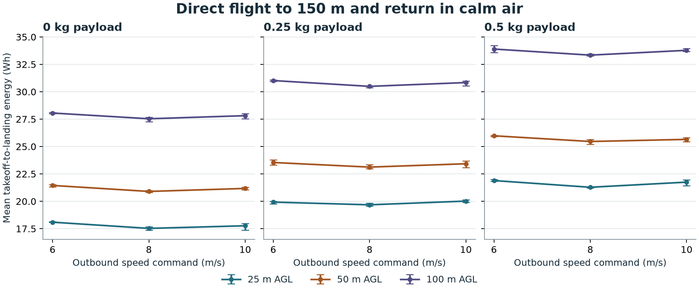
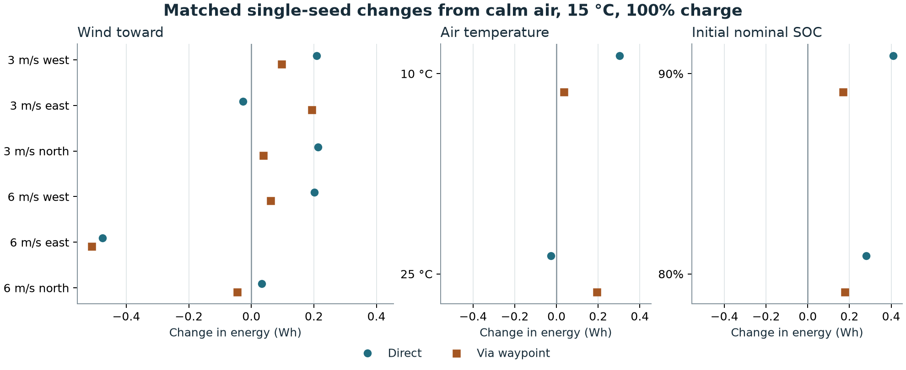
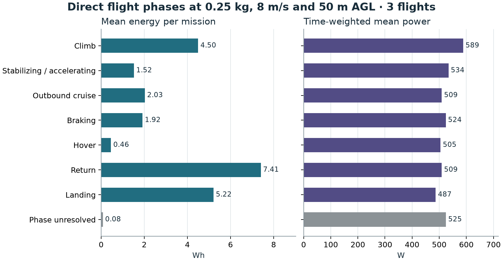

# نتائج مهمة Matrice 100 إلى وجهة على بُعد 150 م ثم العودة

اجتازت **131 رحلة محاكاة** التحقق من طاقة الإقلاع إلى الهبوط والوصول إلى الوجهة والعودة. سجّلت الحملة 143 محاولة لعدد 131 حالة وبذرة مسجّلة. من الرحلات المقبولة، 81 لتجربة الحمولة والسرعة والارتفاع، و12 لبديل المسار، و20 للرياح وحرارة الهواء وشحن البداية، و18 للتحقق المنفصل من الاختيارات. تضم الجداول 21,816 فترة زمنية، توفرت مدخلات الملاحة السابقة للتنبؤ في 21,816 منها. تحتفظ الجداول بطاقة الرحلة التي كتبها المسجّل عند الهبوط. [ملف الرحلات](mission_flights.csv) · [فترات القدرة والطاقة](mission_intervals.csv.gz) · [سجل المحاولات](attempt_registry.csv)

## اختيار السرعة والارتفاع والمسار

استُخدمت وجهة تبعد 150 م شرقًا عن نقطة الإقلاع والعودة إلى النقطة نفسها بالحمولة نفسها. استُخدم احتياطي اسمي قابل للتغيير قدره 20%، ولم يحدد للمهمة موعد وصول. جُرّبت سرعات ذهاب 6 و8 و10 م/ث وارتفاعات 25 و50 و100 م. يتبع المسار البديل نقطة وسطية، فيبلغ طوله المخطط مع العودة 317.71 م مقابل 300 م للمباشر. بقيت سرعة العودة محدودة بأربعة م/ث في كلا المسارين.

| الحمولة | اختيار المتنبئ | الطاقة المتوقعة | الطاقة المرصودة للتحقق | زمن المهمة المرصود | شحن الهبوط الاسمي | الوفر عن المباشر عند 8 م/ث و50 م |
|---|---|---:|---:|---:|---:|---:|
| 0 كغ | مباشر، 8 م/ث، 25 م | 17.52 Wh | 17.56 Wh | 134.67 ث | 82.42 % | 3.35 Wh (16.0%) |
| 0.25 كغ | مباشر، 8 م/ث، 25 م | 19.50 Wh | 19.77 Wh | 136.75 ث | 80.21 % | 3.40 Wh (14.7%) |
| 0.5 كغ | مباشر، 8 م/ث، 25 م | 21.51 Wh | 21.33 Wh | 135.44 ث | 78.65 % | 4.06 Wh (16.0%) |

مقارنة أقرب بديل إلى الاختيار المتوقع. الفرق الموجب يعني أن البديل استهلك طاقة أكثر.

| الحمولة | البديل المقارب | متوسط فرق الطاقة الفعلي | ترتيب التكرارين المستقلين |
|---|---|---:|---|
| 0 كغ | مباشر، 10 م/ث، 25 م | +0.339 Wh | استهلك الاختيار المتوقع طاقة أقل في المرتين |
| 0.25 كغ | مباشر، 10 م/ث، 25 م | -0.050 Wh | اختلف الترتيب أو تساوت الطاقة بين التكرارين |
| 0.5 كغ | مباشر، 10 م/ث، 25 م | +0.339 Wh | استهلك الاختيار المتوقع طاقة أقل في المرتين |

جُمّدت التوقعات قبل رحلات البذرتين 2711 و2712. توفّر 12 زوجًا يستوفي الاحتياطي من 12 زوجًا مبرمجًا. كان المئين التسعون للخطأ المطلق في طاقة الظروف المرجعية 0.371 Wh. يحمل كل بديل قريب من الأول إشارة تقارب. تحقق الوفورات على محاكاة المهمة المحددة، وتبقى أجزاء فضاء السرعة والارتفاع والمسارات خارج الشبكة غير مختبرة. [التوقع المجمد](confirmation_protocol.json) · [القياسات المزدوجة](confirmed_savings.csv) · [حالة كل مقارنة](confirmation_coverage.json)



## التحقق من البطارية والبيانات

طابق وسم كل رحلة مقبولة سجلَّ Gazebo النهائي وحدّي كاشف الهبوط المستقل في PX4. بلغ أقصى خطأ عددي لفحص معادلة الجهد 3.6e-15 V، ولحاصل الجهد في التيار 5.7e-14 W، على العينات التي يدعمها نموذج الحزمة. وصلت الشحنة المسحوبة إلى حد الملاءمة في 13 من 131 رحلة. تراوحت مساهمة تقدير القدرة البديل من 1.1% إلى 50.6% من طاقة الرحلة. تظهر أعلام التغطية في كل سجل. [التحقق والعدادات](verification.json) · [قاموس الأعمدة](column_dictionary.csv)

على 60 رحلة ميدانية محجوزة من CMU، انخفض متوسط خطأ الجهد عند إدخال التيار المقاس من 0.623 إلى 0.610 V. توجد حالات متساوية في الحمولة والسرعة والارتفاع لـ17 من 27 تركيبة في هذه الحملة. يعرض جدولها قدرات ومدد الطرفين. يظل طول المسار وتقسيم مراحله مختلفين، فلا تستعمل فروق الطاقة الكلية كنسبة خطأ ميداني لمهمة 150 م. [مقارنة الأوامر المتطابقة](field_command_context.csv) · [اختبار CMU](field_holdout.json)

## جاهزية تدريب نموذج الطاقة

بلغ متوسط الخطأ المطلق على عائلات أوامر محجوبة في الرحلات المرجعية الجديدة **0.197 Wh**، مقابل 6.321 Wh للمرجع الزمني ذي قدرة المراحل المنشورة و4.191 Wh لمرجع متوسط التدريب. عند ضم الحالات الاستكشافية بلغ الخطأ 0.224 Wh. وفي التنبؤ أثناء الطيران بلغ خطأ القدرة للفترة التالية 5.69 W على 93 رحلة مرجعية. تصلح هذه النتائج لتدريب نموذج يتنبأ بمخرجات المحاكاة ضمن الشروط المسجلة. تبقى معايرة سعة TB47D الفعلية ومنحنى الجهد المفتوح، وحرارة الخلايا، وعزم المحركات وخسائر ESC 620D والتحقق الميداني لنفس المهمة مفتوحة. [تقسيم البيانات وطريقة الاستعمال](../../../docs/m100_reaudit/mission_training_ar.md) · [أخطاء الطاقة](preflight_reference/evaluation.json) · [أخطاء القدرة](online_reference/evaluation.json)

## حساسية الرياح وحرارة الهواء وشحن البداية

تُغيّر المقارنة متغيرًا واحدًا عند 0.25 كغ و8 م/ث و50 م. استُخدمت بذرة واحدة لكل زوج. قيمة موجبة تعني استهلاكًا أكبر من مرجع المسار نفسه. أثّرت حرارة الجو في كثافة الهواء، بينما بقيت معاملات البطارية الحرارية غير مقاسة. [جدول التأثيرات](environment_and_soc.csv) · [الفروق المقترنة للحمولة والسرعة والارتفاع](factorial_paired_effects.csv)



في المسار المباشر عند شحن ابتدائي اسمي 80%، بلغ أدنى جهد مدعوم 21.19 V مقابل 21.65 V عند 100%. بلغت طاقة المهمة 23.27 Wh مقابل 22.99 Wh للمرجع، وغطّى تقدير قدرة الطائرة البديل 44.8% من طاقة رحلة 80%. هذه مقارنة لبذرة واحدة ضمن نموذج البطارية المنقول من CMU.

## أثر الجهد في التيار والدفع داخل المحاكي

بلغ أدنى جهد مدعوم تحت الحمل 21.09 V، وأعلى تيار مدعوم 29.99 A عبر الرحلات. وصل سقف الدفع المتاح المحسوب من مربع نسبة سرعة المحرك إلى 71.1% من السقف الاسمي. في 19 من 131 رحلة احتوت الرسائل المنشورة على أمر محرك مقصوص عند السقف. يتعلق هذا السقف بأقصى دفع يسمح به النموذج في تلك اللحظة. يحلّ نموذج البطارية الجهد والتيار معًا حتى يساوي حاصل ضربهما القدرة المطلوبة، ويبقى فقد التوصيل في ESC 620D وعزم كل محرك خارج القياس المتاح. [مقاييس الحزمة والدفع لكل رحلة](mission_flights.csv)

## الطاقة والمسافة في مراحل الرحلة

جُمعت طاقات المراحل في 131 رحلة. بلغ أكبر فرق عن طاقة الإقلاع إلى الهبوط 7.1e-15 Wh. تعذّر تحديد اسم المرحلة في 0.39% من الزمن الجوي، وتظل طاقته مدرجة في المجموع. أتاحت سجلات الجهد والتيار تكاملًا مستقلًا لطاقة 95.6% من الزمن الجوي على فترات متجانسة المصدر. بلغ أكبر فرق مطلق بين تكامل القراءات المنشورة وعداد خطوة الفيزياء للفترات نفسها 0.0008 Wh. [طاقة المقاطع وأزمنتها ومسافاتها](mission_phases.csv) · [التحقق لكل رحلة](mission_phase_checks.csv)



يعرض الرسم المسار المباشر عند حمولة 0.25 كغ وسرعة ذهاب 8 م/ث وارتفاع 50 م. يجمع المسجّل الاستقرار والتسارع في حالة واحدة. حُسبت قدرة كل مرحلة من طاقتها المجمعة ومدتها المجمعة، وأُدرجت طاقة الفترات التي تعذرت تسميتها.

يعرض جدول أخطاء التنبؤ متوسط الخطأ المطلق والجذر التربيعي لمتوسط مربع الخطأ والانحياز. يذكر عدد الرحلات وعائلات الأوامر الداخلة في كل شريحة من الحمولة والسرعة والارتفاع والرياح والمسار، وكذلك مرحلة الرحلة في تنبؤ القدرة. [أخطاء التنبؤ بحسب ظروف التشغيل](error_breakdown/held_out_errors_by_condition.csv)

## تحقق الإصدار المثبّت بعد الهبوط

أُعيدت رحلة مباشرة بحمولة صفر وسرعة ذهاب 6 م/ث وارتفاع 25 م بالبذرة نفسها عند 3 خطوات زمنية. يسجّل الإصدار المثبّت تعافي جهد الفرعين عندما تؤكد إشارات المحركات والبطارية وPX4 توقف الحمل بعد فصل المحركات. خُصصت هذه الرحلات للتحقق الهندسي.

| خطوة الحساب | طاقة الإقلاع إلى الهبوط | زمن الطيران | الراحة المؤكدة في نافذة التحقق | تغير الشحنة أثناء الراحة |
|---|---:|---:|---:|---:|
| 4 ملي ثانية | 18.109 Wh | 138.73 ث | 8.53 ث | 0 Ah |
| 2 ملي ثانية | 17.628 Wh | 135.19 ث | 8.50 ث | 0 Ah |
| 1 ملي ثانية | 18.067 Wh | 138.64 ث | 8.53 ث | 0 Ah |

عند الانتقال من 4 إلى 2 ملي ثانية تغيرت طاقة الرحلة -0.481 Wh (-2.66%)، وزمنها -3.54 ث، ومسافتها الأفقية الفعلية -7.45 م، ومتوسط القدرة -0.49 W.

عند الانتقال من 2 إلى 1 ملي ثانية تغيرت طاقة الرحلة +0.439 Wh (+2.49%)، وزمنها +3.45 ث، ومسافتها الأفقية الفعلية +3.96 م، ومتوسط القدرة -0.28 W.

تغيّر اتجاه فرق الطاقة بين خطوتَي التنقيح. جاء معظم الفرق في هذه الحالة من تغير مدة الرحلة مع استجابة المتحكم.

تشمل المقارنة تغير التتبع والتوقيت في منظومة التحكم. وهي تخص هذه الحالة والبذرة. كان أقصى فرق عن الاضمحلال الأسي المتوقع للفرعين 1.2e-15 V. [سجل التحقق من البطارية وحجم الخطوة](postflight_verification.json) · [تجارب إعداد الحملة](engineering_setup.json)

رُفضت محاولات قبل إعداد جدول التدريب للأسباب الآتية. يحفظ السجل هوية كل رحلة أصلية أو بديلة، وتعاد الحالات بإعداداتها وبذورها الأصلية. [سجل المحاولات](attempt_registry.csv) · [إعداد المحاولات البديلة](retry_policy.json)

| سبب الاستبعاد | عدد المحاولات |
|---|---:|
| غابت القدرة عن جزء من الفترة الجوية | 6 |
| انقطع تسلسل إشارات الإقلاع والهبوط في PX4 | 2 |
| تجاوز الميل حد مراقب الرحلة مدةً متصلة | 2 |
| غابت بيانات الموضع في أثناء الهبوط | 1 |
| تعذّر الاستقرار فوق نقطة الهبوط | 1 |

## تشغيل الحملة مجددًا

ينفّذ الأمر التالي حملة جديدة باستخدام النسخة المثبّتة على جهاز المشروع. يحفظ النتائج والسجلات في مجلدين جديدين ويطبع مساريهما. [دليل إعادة التشغيل والتدريب](../../../docs/m100_reaudit/mission_training_ar.md)

```bash
/usr/bin/python3 -m tools.m100_reaudit.mission_repeat --workers 2
```

يشمل التحقق النهائي فتح ملف التدريب في قارئ جداول مستقل، ومطابقة الأعمدة بقاموسها، واستخدام نموذجي الطاقة والقدرة في نسخة مستقلة من كود المشروع. [سجل التحقق النهائي](delivery_checks.json)
