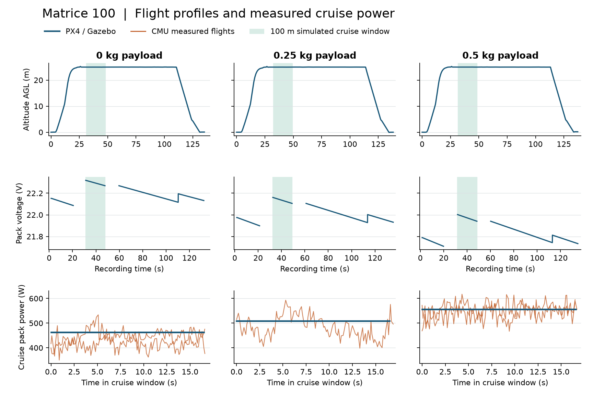

# ثلاث رحلات Matrice 100 بعد ربط جهد البطارية بالمحركات

اكتملت الرحلات الثلاث داخل PX4 وGazebo يوم 22 نوفمبر 2026 بتوقيت بغداد. عادت كل طائرة إلى مسافة أفقية مقدّرة أقل من 5 سم من نقطة الإقلاع، وسجّل PX4 الهبوط وفصل التسليح. الأرقام معقولة لوصف أثر الحمولة في **متوسط قدرة الطيران المستقيم**. أمّا القدرة اللحظية المحاكاة فتظل ثابتة داخل المرحلة، وتُظهر القياسات الميدانية تذبذبًا واضحًا عند السرعة والحمولة نفسيهما. [ملخص الأرقام](summary.csv) · [حالات الطيران المسجلة في PX4](px4_control.csv)

## مسار الطيران

ثُبّتت الأوامر قبل الإقلاع عند ارتفاع 25 م، وسرعة أرضية 6 م/ث، ومقطع قياس 100 م شرقًا، ورياح صفر وحرارة جو مرجعية 15°م. شُغّلت كل حمولة مرة واحدة في عالم جديد مع إعادة تهيئة عداد شحنة الحزمة، والبذرة 1701، وخطوة فيزيائية 0.004 ث. تشمل مدة التسجيل الصعود والتسارع والقياس والكبح والعودة والهبوط. تعتمد أرقام الموضع على تقدير PX4. [إعدادات التجربة وبصمات الإصدارات](protocol.json) · [مقاييس المسار](motion.csv)

| الحمولة (كغ) | مدة تسجيل الحركة (ث) | مسافة القياس وفق مدير الرحلة (م) | متوسط السرعة في المقطع (م/ث) | نطاق الارتفاع في المقطع (م) | أقصى انحراف جانبي عن خط بداية المقطع (م) |
|---:|---:|---:|---:|---:|---:|
| 0 | 135.28 | 100.186 | 6.058 | 24.977–25.006 | 0.109 |
| 0.25 | 138.15 | 100.008 | 6.050 | 24.975–25.004 | 0.116 |
| 0.50 | 137.25 | 100.401 | 6.051 | 24.988–25.014 | 0.071 |

ظلّ PX4 في وضع التحكم الخارجي طوال مقطع القياس، وكان أكبر ميل كلي فيه 1.68°. خلال التسارع بلغ الميل 38.81–39.04°، وتجاوز 35° مدة 0.36 ثانية تقريبًا في كل رحلة. يسمح إعداد PX4 المسجل بميل 45°، فيما تنشر DJI للطائرة القياسية حدًّا قدره 35° وكتلة إقلاع قصوى 3.60 كغ. كتل المنصة البحثية المحاكاة هي 3.68 و3.93 و4.18 كغ. لذلك تنطبق نتائج الحركة على تكوين المشروع ومتحكمه. تقدمت الطائرة 15.11–15.22 م شرقًا أثناء الكبح بعد بوابة القياس. في رحلة 0.25 كغ كانت المسافة بين أول وآخر عينة موضع **داخل** المقطع 99.659 م، وقرأ المدير 100.008 م عند إغلاق البوابة. الفارق متسق مع زمن تحديث الموضع. [سجلات التحكم](px4_control.csv) · [مواصفات DJI](https://www.dji.com/matrice100)

## القدرة والجهد والتيار

قيم المحاكاة التالية متوسطات زمنية لعينات الحزمة خلال المقطع. قيم CMU قياسات عند مخرج البطارية، بوزن متساوٍ لكل رحلة لها مقطع صالح. فرق القدرة محسوب بالنسبة إلى متوسط CMU. [المقارنة الرقمية](summary.csv) · [المقاطع الميدانية لكل رحلة](cmu_context_flights.csv)

| الحمولة (كغ) | القدرة المحاكاة (W) | قدرة CMU (W) | الفرق | الجهد المحاكى / CMU (V) | التيار المحاكى / CMU (A) | طاقة المقطع المغطاة (Wh) |
|---:|---:|---:|---:|---:|---:|---:|
| 0 | 463.08 | 431.22 | ‎+7.39% | 22.29 / 22.35 | 20.77 / 19.29 | 2.120 |
| 0.25 | 508.88 | 484.17 | ‎+5.10% | 22.13 / 20.94 | 22.99 / 23.13 | 2.330 |
| 0.50 | 556.15 | 548.41 | ‎+1.41% | 21.97 / 21.00 | 25.31 / 26.12 | 2.563 |

عند ثبات القدرة داخل كل مقطع هبط جهد الحزمة بين بدايته ونهايته بمقدار 0.050 و0.055 و0.062 V على التوالي، وزاد التيار بمقدار 0.046 و0.057 و0.071 A. طابق حاصل الجهد والتيار القدرة المطلوبة ضمن دقة الحساب. يزيد جهد المحاكاة على متوسط القياس بنحو 1.19 V عند حمولة 0.25 كغ و0.97 V عند 0.50 كغ. حالة الشحن الابتدائية، وهوية البطارية وحرارتها، والرياح المحيطة في الرحلات الميدانية غير مطابقة أو غير معروفة. هذه فروق وصفية في العينة. [بيانات الحزمة حسب المرحلة](phases.csv) · [شروط ملاءمة الجهد](https://github.com/Abdulah20/master/blob/0e3390b3b149436b7e3f4de1d837b298198cf8c2/docs/m100_reaudit/cmu_calibration_ar.md)

الصف السفلي يُظهر سبب الحكم على الرتابة. الانحراف المعياري للقدرة في كل مقطع محاكى أصغر من ‎0.001 W، وفي المقاطع الميدانية الخمسة بلغ 19.95–42.41 W، أي 4.64–8.76% من متوسط المقطع. الفراغ في منحنى الجهد يعني أن تقدير الجهد تحت الحمل غير متاح لتلك الفترة. [عينات CMU المقاسة](data/cmu_windows.csv.gz) · [متوسطات الرحلات](cmu_context.csv)

## استجابة المحركات وتغطية طاقة الرحلة

| الحمولة (كغ) | وسيط سرعة الدوّارات في المقطع (راديان/ث) | وسيط سقف السرعة المعتمد على الجهد (راديان/ث) | زمن الحزمة المغطى / زمن تسجيل الحزمة (ث) | التغطية | الطاقة المحسوبة خلال الفترات المغطاة (Wh) |
|---:|---:|---:|---:|---:|---:|
| 0 | 606.32 | 817.13 | 108.036 / 135.204 | 79.91% | 14.125 |
| 0.25 | 626.53 | 811.23 | 110.556 / 138.096 | 80.06% | 15.919 |
| 0.50 | 646.14 | 805.31 | 109.492 / 137.192 | 79.81% | 17.231 |

ازدادت سرعة الدوّارات المرصودة من مفاصل Gazebo مع الحمولة وانخفض سقف السرعة مع الجهد. ظهر قصّ قصير لأمر محرك في كل رحلة أثناء التسارع، حين استخدمت الإضافة آخر سقف جهد متاح. كانت الفترات من أول عينة مقصوصة إلى أول عينة تالية غير مقصوصة 0.080 و0.104 و0.132 ث تقريبًا. جميع نقاط الحمل الكهربائي المعلوم بقيت دون السقف. لذلك تبيّن هذه الرحلات عمل المحدِّد برمجيًا، وتظل استجابة الدفع عند التشبع بحمل معلوم وخريطة الدفع والعزم وتيار كل محرك وخسائر ESC 620D غير متحققة ميدانيًا. لا توجد خسائر إضافية مفترضة في هذا الحساب. [حدود نموذج المحرك والبطارية](https://github.com/Abdulah20/master/blob/0e3390b3b149436b7e3f4de1d837b298198cf8c2/docs/m100_reaudit/pack_drive_ar.md) · [البيانات الكهربائية الكاملة](electrical.csv)

سُجّلت 7,910 عيّنات لحالة الإضافة، منها 6,320 بقيم مؤهلة للجهد والتيار. كُوملت القدرة عبر الفترات المتصلة ذات التغطية الكهربائية، ومنها أكثر من 99.7% من زمن كل مقطع قياس. فترات الاستقرار والكبح خصوصًا تفتقر إلى حمل معاير. لهذا لا توجد قيمة معتمدة لطاقة المهمة كاملة، أو لزمن التفريغ الكامل، أو لمنحنى جهد الدائرة المفتوحة مع حالة شحن TB47D. [مدد التغطية حسب المرحلة](phases.csv) · [منشأ كل تسجيل](evidence/index.json)

تحتفظ ملفات `manager_1hz.csv` كذلك بتصدير مدير الرحلة القديم للمراجعة. يعطي ملخص هذا المدير 17.50 و19.71 و21.40 Wh في الحالات الثلاث، ويشمل تقديرًا للقدرة أثناء الاستقرار والكبح. يصرّح سجل المنشأ بأن أعمدة CSV تلك تخص حساب المدير. عند دراسة ربط الجهد بالمحركات تُستخدم سلاسل `*.pack.csv.gz` وأعلام التغطية فيها. [مثال من سجل المنشأ](evidence/load_000/provenance.json) · [نتائج إضافة الحزمة](electrical.csv)

## مرجع المقارنة واستخدام البيانات

من سجلات التطوير في حملة Rodrigues وزملائه طابقت سبع رحلات أوامر الارتفاع والسرعة والحمولة. حُدد أول مقطع مستقيم متصل يتجاوز إزاحته الأفقية 100 م، باستخدام الموضع والسرعة فقط. شملت الشروط سرعة ضمن 0.6 م/ث من المطلوب، وارتفاعًا ضمن 3 م، وسرعة عمودية مطلقة حتى 1.5 م/ث، وإزاحة صافية لا تقل عن 99% من طول المسار. حققت الرحلات 3 و170 و17 و205 و230 الشروط، بمجموع 560 عينة. لم تتضمّن الرحلتان 204 و255 مقطعًا مستوفيًا لهذه الشروط، وسُجّل ذلك في الجدول. ينتمي المرجع إلى حملة تطوير نموذج القدرة، وبقيت مجموعة الاختبار المحجوزة خارج التحليل. عينات CMU مشتقة من قياسات Rodrigues وآخرين، مرخصة بموجب CC BY 4.0، واقتصر الاشتقاق على انتقاء المقاطع وحساب القدرة والزمن النسبي والإحصاءات. [حملة القياس المنشورة](https://www.nature.com/articles/s41597-021-00930-x) · [البيانات الأصلية](https://doi.org/10.1184/R1/12683453) · [الترخيص](https://creativecommons.org/licenses/by/4.0/)

تصلح الرحلات لفحص خط استخراج بيانات الطاقة ولمقارنة متوسطات المراحل وأثر الحمولة في هذا السيناريو. التدريب على صفوف القدرة المحاكاة بوصفها قياسات لحظية سيعلّم النموذج متوسطات المراحل المفروضة. تجربة واحدة لكل حمولة وسرعة واحدة وهواء ساكن تحدّ كذلك من تقدير التكرارية والتعميم. في سلاسل الحزمة يميز الحقل `electrical_pair_qualified` النقاط الكهربائية المؤهلة و`previous_interval_covered` الفترات القابلة للتكامل. تستعمل الحركة والحزمة توقيتين بمعدلي تحديث مختلفين، وتحمل كل سلسلة طوابعها الزمنية.

تضم [السلاسل المستخرجة](data) ملف حركة وملف حزمة لكل حمولة. يحتفظ [فهرس الأدلة](evidence/index.json) ببصمات ملفات PX4 الأصلية وبأسماء الملفات داخل الحزمة المحلية. تحتوي حزمة ZIP كذلك على الجداول بصيغة CSV قابلة للفتح مباشرة في مجلد `csv`، وعلى ملفات PX4 الأصلية الثلاثة في `ulog`. يمكن تدقيق السلاسل المنشورة من جذر المشروع باستخدام `python3 -m tools.m100_reaudit.pack_drive_analysis --verify-saved`، والتحقق من ملفات الإصدار باستخدام `sha256sum -c SHA256SUMS` من مجلد النتائج.
