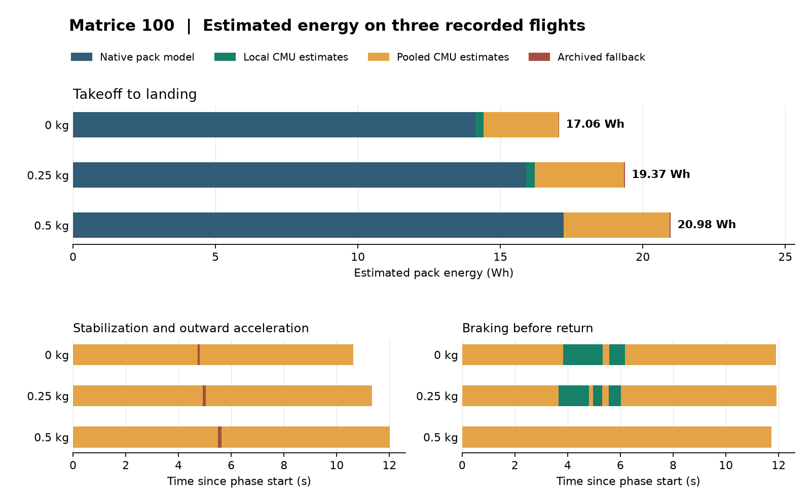

# معايرة قدرة المناورات وطاقة ثلاث رحلات Matrice 100

بلغت الطاقة التقديرية من الإقلاع إلى الهبوط **17.06 و19.37 و20.98 واط·ساعة** عند حمولات 0 و0.25 و0.50 كغ على الترتيب. حُسبت القيم من السجلات السابقة للمسارات المنفّذة، في هواء ساكن وبسرعة مطلوبة 6 م/ث وارتفاع مطلوب 25 م. لم تبقَ فترة جوية بلا تقدير عددي في هذه الرحلات. تختلف قوة الإسناد الميداني من فترة إلى أخرى. [ثلاثة صفوف بخصائص المهمة وهدف الطاقة التقديري](training_estimates.csv) · [تفاصيل الرحلات](practical_flights.csv)

| الحمولة (كغ) | زمن الطيران (ث) | الطاقة التقديرية (Wh) | متوسط القدرة (W) | متوسط القدرة المقاس في رحلات CMU المشابهة (W) | فرق متوسط القدرة |
|---:|---:|---:|---:|---:|---:|
| 0 | 130.652 | 17.06 | 470.1 | 465.5 | ‎+1.00% |
| 0.25 | 133.852 | 19.37 | 521.0 | 503.5 | ‎+3.48% |
| 0.50 | 133.248 | 20.98 | 566.8 | 558.9 | ‎+1.41% |

طابقت سبع رحلات تطويرية أوامر السرعة والارتفاع والحمولة، بواقع رحلتين ورحلتين وثلاث. كانت مددها الجوية بين 122.2 و130.3 ث، وطارت على مسارات CMU المختلفة عن خط الذهاب والعودة في المحاكاة. بلغ متوسط طاقة الرحلات الميدانية المناظرة 16.35 و17.44 و19.05 Wh. زادت طاقة المحاكاة عليها بنسبة 4.32% و11.06% و10.13%، وتأثر الفرق بالمدة والمسار. المقارنة في عمود النسبة أعلاه تخص **متوسط القدرة الجوية**. لا تعطي دقة طاقة المهمة الكاملة على مسار ميداني مطابق. [معرّفات الرحلات والمدد والطاقات المقاسة](matched_field_flights.csv)

## قدرة التسارع والاستقرار والكبح

يجمع الجدول متوسط القدرة أثناء المناورات المحاكاة وفي المقاطع الميدانية من رحلات التدريب ذات ارتفاع 25 م والحمولة نفسها. استُخدمت سرعات الأوامر المتاحة في حساب المرجع الميداني، وأُعطيت كل رحلة وزنًا متساويًا بعد وزن عيناتها بالزمن. يمثل الاستقرار هنا بطء الحركة الأفقية إلى أقل من 0.6 م/ث مع تغيّر سرعة صغير. متوسطات المحاكاة تخص الزمن المصنَّف بهذه الحركة داخل مرحلتي الاستقرار والكبح. [القدرة الميدانية ومدى متوسطات الرحلات](field_power_at_flight_altitude.csv) · [القدرة بحسب حركة المحاكاة](practical_segments.csv)

| الحمولة | التسارع، محاكاة / ميدان (W) | الاستقرار البطيء، محاكاة / ميدان (W) | الكبح، محاكاة / ميدان (W) |
|---|---:|---:|---:|
| 0 كغ | 498 / 482 | 475 / 507 | 463 / 472 |
| 0.25 كغ | 557 / 553 | 543 / 551 | 530 / 488 |
| 0.50 كغ | 596 / 598 | 577 / 584 | 562 / 513 |

أكبر فرق ظاهر في الكبح عند 0.50 كغ، نحو 49 W. يعود متوسط الكبح الميداني لهذه الحمولة إلى ثلاث رحلات و13.46 ثانية، ومتوسط الاستقرار البطيء إلى رحلتين و1.01 ثانية فقط. لذلك يمكن أن تتقارب متوسطات القدرة على مستوى الرحلة مع بقاء أخطاء أكبر داخل مناورة معيّنة.

## مصادر الطاقة وما بقي تقريبيًا

| الحمولة | من سجل نموذج الحزمة (Wh) | من مقاطع CMU شديدة الشبه (Wh) | من النموذج الميداني الأوسع (Wh) | من تقدير مدير الرحلة المسجّل (Wh) |
|---|---:|---:|---:|---:|
| 0 كغ | 14.1215 | 0.2886 | 2.6251 | 0.0267 |
| 0.25 كغ | 15.9114 | 0.3011 | 3.1293 | 0.0283 |
| 0.50 كغ | 17.2229 | 0 | 3.7228 | 0.0330 |

قبل استخدام النموذج الأوسع، بقيت **20.544 و21.408 و23.812 ث** خارج تغطية سجل الحزمة والمطابقة الميدانية الدقيقة. غطّى النموذج الأوسع منها 20.344 و21.212 و23.604 ث. أبرز مصادر عدم اليقين هي بطء الطائرة مدة أطول من المقاطع الميدانية المتاحة، ومناورات تجاوز فيها الميل أو التسارع مجال التدريب. أسهم النموذج الأوسع بنحو 15–18% من إجمالي طاقة كل رحلة. سجلات القياس الميداني المتاحة تدعم توقفات قريبة من المستوى حتى نحو 2.3–2.4 ث بحسب الحمولة وتعريف المعايرة، أما الوقفة قبل العودة في المحاكاة فتقارب 8 ث عند عدّ الزمن تحت 1 م/ث.

استُخدم تقدير مدير الرحلة المحفوظ خلال **0.200 و0.196 و0.208 ث** فقط، شملت تبدّل المراحل وتسليم إشارات الحالة وقصّ أمر محرك. كانت إشارة القص فعالة لمدة 0.080 و0.104 و0.132 ث على الترتيب. التيار الفعلي أثناء القص وخسائر المحرك و620D وطاقة كل ذراع تبقى غير مقاسة، ولا تدخل خسارة مفترضة للمتحكم في الميزانية. [الأزمنة والأسباب لكل مرحلة](practical_segments.csv) · [تتبّع أصل النتيجة](practical_audit.json)

## ما تم قياسه وما تم تقديره

قياسات المرجع هي الجهد والتيار عند مخرج بطارية طائرة CMU المجهّزة، مع موضع الطائرة وسرعتها واتجاهها. حُسبت القدرة بالواط من حاصل الجهد والتيار في العينة نفسها، واستُخدمت الفواصل الزمنية الأصلية لكل تسجيل. أما رحلات المشروع الثلاث فهي تسجيلات PX4 وGazebo السابقة بالحمولات 0 و0.25 و0.50 كغ. الهدف هنا تقدير استهلاك الحزمة أثناء المسار المنفّذ، بما فيه العودة والهبوط بعد مقطع القياس البالغ 100 م. [مصدر قياسات CMU، Rodrigues وآخرون، بترخيص CC BY 4.0](https://kilthub.cmu.edu/articles/dataset/Data_Collected_with_Package_Delivery_Quadcopter_Drone/12683453) · [تسجيل الرحلات الثلاث وإعداداتها](../pack_drive_three/report_ar.md)

فُحصت **75 رحلة تدريب**، وأسهمت 73 منها بـ **17,636 نقطة** لحركة صالحة للمعايرة. لم توفّر الرحلتان 146 و236 فترة مستوفية للشروط. في المطابقة المحلية تُقارن نقاط الفئة الحركية والحمولة نفسيهما في السرعة الأفقية وتغيّرها والسرعة الرأسية ومدة البطء قرب المستوى والارتفاع والميل. يُشترط وجود ثلاث رحلات مختلفة على الأقل لحساب المتوسط المحلي. يرصد تغيّر السرعة على الثانية السابقة التسارع والكبح. يساعد الميل المسجّل على تمييز الاندفاع الأولي حين لا تزال السرعة منخفضة. استُبعدت الانعطافات القابلة للرصد من مسار GNSS، وعند البطء قد يتعذر تحديد الاتجاه. [شروط المطابقة المحلية](model.json) · [النقاط والأزمنة حسب الحمولة والمناورة](support_by_payload_regime.csv)

في الحالات التي لم تجد ثلاثة أمثلة متقاربة، استُخدم **انحدار واحد** مُعايَر على قياسات التدريب نفسها. له قيمة أساس لكل حمولة ومعاملات للسرعة ومربّعها والحركة الرأسية والتسارع والكبح والميل، مع وزن متساوٍ لكل رحلة ووزن زمني لعينات المناورة. يُسجَّل تجاوز نطاق التدريب عند تقريب المدخل أو القدرة إلى أقرب حد مرصود لنفس الحمولة، ويُوسم امتداد زمن البطء. معاملات الانحدار تصف الطلب الكهربائي الكلي عند الحزمة ولا تفصل قدرة العمود أو كفاءة المتحكم. [معاملات النموذج الأوسع ومجالاته](pooled_model.json)

بعد تثبيت المعاملات، بَلغ متوسط الخطأ المطلق للقدرة **41.77 W** والانحياز **‎+9.89 W** على 342.48 ث من مناورات 35 رحلة تطوير، بوزن زمني للعينات وبعد استبعاد الحركة شبه الثابتة. بلغ متوسط الخطأ المطلق لطاقة **مقاطع المناورة المختارة في كل رحلة** 0.0484 Wh، ومتوسط طاقتها المقاسة 1.3727 Wh. عبر جميع الفترات القريبة من الطيران المستوي المؤهلة للمقارنة، بما فيها الحركة شبه الثابتة، كان متوسط خطأ القدرة المطلق 32.78 W على 1,482.96 ث. تنتمي رحلات التطوير إلى الحملة نفسها. بقيت الرحلات الستون المحجوزة للاختبار خارج هذا الحساب. [النتائج بحسب نوع الحركة](pooled_development.csv) · [الفروق لكل رحلة](pooled_development_by_flight.csv)

مرجع البداية والنهاية هو الانتقال المسجّل لحالة الهبوط في PX4، مع استمرار التسليح بين الحدين. يشترك متحكم PX4 وGazebo في ساعة المحاكاة. يُقسَّم الزمن عند تغير المرحلة أو حالة المحرك أو تقرير الحركة، ويُعطى كل جزء مصدر قدرة واحدًا. يُكامل حاصل الجهد والتيار المتزامنين من إضافة الحزمة عندما يؤكد سجلها صلاحية الفترة. تُستخدم المطابقة المحلية أو الانحدار الميداني في مناورات الاستقرار والكبح، ثم تقدير مدير الرحلة في الفترات القصيرة المتبقية. استُبعد الزمن على الأرض، ولهذا تختلف طاقة الحزمة في هذا التقرير قليلًا عن ملخص التسجيل السابق الذي شمل الزمن قبل الإقلاع وبعد الهبوط. [إشارات الإقلاع والهبوط من ULog](ulog_flight_flags.csv) · [تقسيم زمن الطيران](transient_airborne_audit.json)

## استخدام الأرقام

عمود `estimated_airborne_energy_Wh` في جدول التدريب هو **هدف محاكاة تقديري** يغطي الزمن بين الإقلاع والهبوط. تستخدم الصفوف الحمولة وأوامر السرعة والارتفاع والرياح والمسافة المخططة لمقطع القياس. في ميزانية المطابقة الصارمة، `qualified_subtotal_Wh` مجموع جزئي و`total_Wh` فارغ في الرحلات الثلاث. للمقارنة الحسابية فقط، يعطي ملء الفجوات الصارمة كلها بتقدير المدير السابق 16.97 و19.15 و20.82 Wh. لم تُعدّل المعايرة اللاحقة طوابع السجلات أو مسارات الطيران أو شحنة البطارية وجهدها ودفعها أثناء تسجيل الرحلة. [أمثلة التدريب](training_estimates.csv) · [الميزانية الصارمة](transient_airborne_flights.csv) · [المقارنة بتقدير المدير](conditional_reference.csv)

تصلح الصفوف الثلاثة أمثلة أولية موضحة المصدر، وفيها مسار واحد وسرعة واحدة وتكرار واحد لكل حمولة. عند تدريب نموذج يتنبأ قبل الإقلاع، تُستخدم خصائص المهمة المعروفة مقدمًا وتُقيَّم قدرته على التعميم برحلات ميدانية كاملة. ولإعادة اشتقاق النتائج من الملفات المحفوظة تُشغّل وحدات `transient_cmu` ثم `transient_pooled` ثم `transient_airborne` ثم `transient_practical` ثم `transient_summary` تحت `tools.m100_reaudit` من جذر المشروع. [معايرة الطاقة المقاسة ووصف أهداف التدريب](../../../docs/m100_reaudit/cmu_calibration_ar.md) · [أداة إعداد جدول التدريب والمقارنات](../../../tools/m100_reaudit/transient_summary.py)
